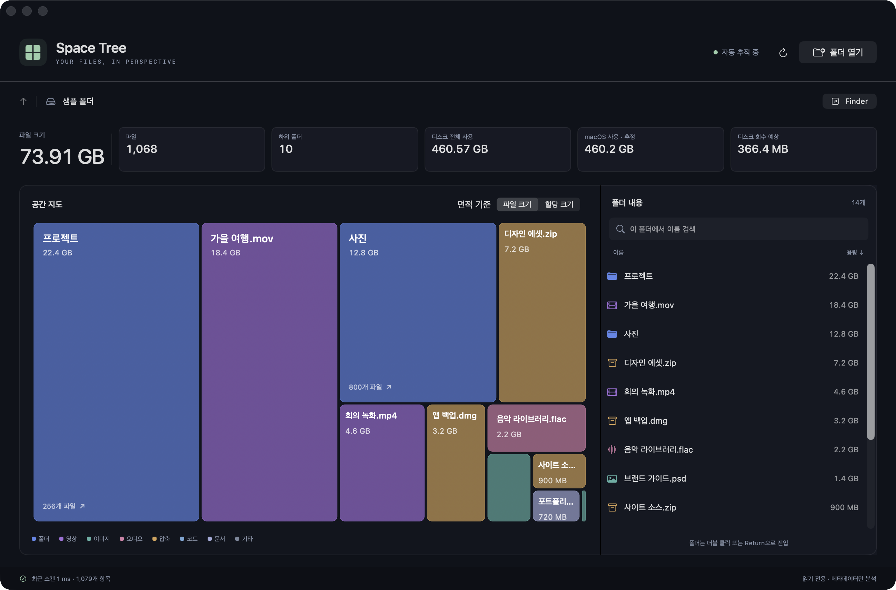

# Space Tree

**디스크 공간을 눈으로 탐색하세요.**

Space Tree는 macOS용 파일 용량 분석기입니다. 큰 파일과 폴더를 트리맵으로 한눈에 찾고, 폴더 안으로 들어가며 공간이 어디에 쓰이는지 확인할 수 있습니다. Finder에서 파일이 바뀌면 분석 결과도 자동으로 갱신됩니다.

[**최신 버전 다운로드**](https://github.com/DIMBD-AKE/Space-Tree/releases/latest) · [업데이트 내역](CHANGELOG.md)

*예시 파일로 촬영한 실제 앱 화면입니다.*

## 주요 기능

- **용량을 한눈에** — 파일과 폴더의 크기를 면적으로 보여주는 트리맵과 용량순 목록을 제공합니다.
- **폴더를 따라 탐색** — 트리맵에서 폴더를 클릭해 들어가고, 경로 버튼으로 돌아올 수 있습니다. 이름 검색과 Finder 연결도 지원합니다.
- **변경 사항 자동 반영** — 파일 생성·수정·이동·삭제를 감지합니다. 재분석 중에도 기존 트리맵과 탐색 위치를 유지합니다.
- **분석 중에도 탐색** — 전체 분석이 끝나기 전부터 부분 결과를 확인할 수 있습니다.
- **필요한 용량 정보** — 파일 크기·할당 크기를 전환하고, 상단에서 디스크 전체 사용량과 회수 예상 공간을 확인합니다.
- **가벼운 로컬 분석** — 파일 내용 대신 메타데이터를 조회하고, 바뀐 경로를 중심으로 다시 분석합니다. 용량과 트리맵 변화는 부드럽게 이어집니다.

## 설치

**macOS 13 이상 · Apple Silicon 및 Intel 지원**

1. [최신 릴리스](https://github.com/DIMBD-AKE/Space-Tree/releases/latest)에서 `Space-Tree-…-universal.dmg`를 다운로드합니다.
2. DMG를 열고 **Space Tree.app**을 **Applications**로 옮깁니다.
3. 앱을 실행한 뒤 분석할 폴더 또는 **디스크**를 선택합니다.

배포 앱과 DMG는 Developer ID 서명과 Apple 공증을 거칩니다. 처음 안내에 따라 **전체 디스크 접근**을 허용하면 휴지통과 보호된 폴더를 더 넓게 분석할 수 있습니다. macOS의 시스템 보호나 다른 사용자의 파일 권한은 그대로 적용됩니다.

## 사용 방법

| 작업 | 방법 |
| --- | --- |
| 폴더 열기 | 상단 **폴더 열기** 또는 `⌘O` |
| 하위 폴더로 이동 | 트리맵 클릭 또는 오른쪽 목록에서 더블 클릭 |
| 상위 폴더로 이동 | 경로 버튼 또는 `⌘↑` |
| Finder에서 보기 | 경로 오른쪽 **Finder** 또는 `⇧⌘R` |
| 현재 폴더 경로 복사 | Finder 옆 **경로 복사** |
| 전체 다시 분석 | 새로 고침 또는 `⌘R` |
| 용량 기준 변경 | 공간 지도 제목 옆 **파일 크기 / 할당 크기** |

**파일 크기**는 파일의 길이, **할당 크기**는 파일마다 보고된 디스크 블록 사용량의 합계입니다. APFS 공유 블록·압축·하드 링크 등의 영향으로 폴더 합계와 실제 디스크 사용량은 다를 수 있습니다. **디스크 회수 예상**은 macOS가 제공하는 디스크 전체 추정치입니다.

숨김 파일과 앱 패키지 내부도 분석하며, 심볼릭 링크와 다른 마운트 볼륨은 따라가지 않습니다. 읽을 수 없는 항목은 경고로 안내합니다.

## 개발 및 성능 기록

외부 패키지 없이 SwiftUI와 AppKit으로 만들었습니다. [소스 빌드·로컬 배포 방법](docs/development.md)과 [프로파일링·벤치마크 기록](docs/performance.md)을 확인할 수 있습니다.
